# RentIQ Complete Entity-Relationship (ER) Diagram

The following Mermaid Entity-Relationship diagram represents the complete, real, implemented database schema of the RentIQ platform across all **27 tables** and **29 foreign key relationships**.

## 1. Complete Mermaid ER Diagram

```mermaid
erDiagram
    users ||--o{ bookings : "places (1:N)"
    users ||--o| customer_licenses : "submits (1:1)"
    users ||--o{ customer_license_history : "owns_versions (1:N)"
    users ||--o{ document_verification_logs : "audits (1:N)"
    users ||--o{ notifications : "receives (1:N)"
    users ||--o{ password_reset_tokens : "requests (1:N)"
    users ||--o{ reviews : "writes (1:N)"
    users ||--o{ wishlist : "bookmarks (1:N)"
    users ||--o{ rental_agreements : "signs (1:N)"
    users ||--o{ vehicle_inspections : "inspects_as_admin (1:N)"
    users ||--o{ vehicle_maintenance : "schedules_as_admin (1:N)"
    users ||--o{ vehicle_document_versions : "archives_as_admin (1:N)"

    categories ||--o{ vehicles : "classifies (1:N)"

    vehicles ||--o{ bookings : "reserved_in (1:N)"
    vehicles ||--o{ vehicle_documents : "has_compliance_docs (1:N)"
    vehicles ||--o{ vehicle_document_versions : "has_archived_versions (1:N)"
    vehicles ||--o{ vehicle_inspections : "undergoes (1:N)"
    vehicles ||--o{ vehicle_maintenance : "serviced_in (1:N)"
    vehicles ||--o{ maintenance_reminders : "triggers (1:N)"
    vehicles ||--o{ reviews : "reviewed_in (1:N)"
    vehicles ||--o{ wishlist : "saved_in (1:N)"

    bookings ||--o{ payments : "paid_via (1:N)"
    bookings ||--o| booking_price_breakdown : "itemized_in (1:1)"
    bookings ||--o{ booking_additional_charges : "incurs (1:N)"
    bookings ||--o| rental_agreements : "governed_by (1:1)"
    bookings ||--o{ vehicle_inspections : "inspected_in (1:N)"

    vehicle_inspections ||--o{ inspection_photos : "contains_evidence (1:N)"

    users {
        int user_id PK
        string name
        string email UK
        string password_hash
        enum role "customer, admin"
        timestamp created_at
    }

    categories {
        int category_id PK
        string name UK
        string description
        string image_url
        timestamp created_at
    }

    vehicles {
        int vehicle_id PK
        int category_id FK
        string name
        string brand
        string model
        int manufacturing_year
        string vehicle_color
        string registration_number UK
        string registration_state
        date registration_date
        date registration_validity
        enum fuel_type "petrol, diesel, electric, hybrid, cng"
        string mileage
        string engine_capacity
        string engine_number
        string chassis_number
        string vehicle_identification_number
        int seating_capacity
        string transmission
        decimal price_per_day
        boolean is_available
        string image_url
    }

    vehicle_documents {
        int id PK
        int vehicle_id FK
        enum document_type "rc, insurance, puc, fitness, permit, road_tax"
        string document_number
        date issue_date
        date expiry_date
        string file_path
        enum verification_status "valid, expiring_soon, expired, pending, rejected"
        int version
        text admin_remarks
        timestamp uploaded_at
        timestamp updated_at
    }

    vehicle_document_versions {
        int id PK
        int document_id
        int vehicle_id FK
        enum document_type "rc, insurance, puc, fitness, permit, road_tax"
        int version_number
        string document_number
        date issue_date
        date expiry_date
        string file_path
        string verification_status
        text admin_remarks
        timestamp archived_at
        int archived_by FK
    }

    customer_licenses {
        int id PK
        int user_id FK,UK
        string license_number
        string holder_name
        date date_of_birth
        date issue_date
        date expiry_date
        string vehicle_class
        string front_document_path
        string back_document_path
        enum verification_status "not_submitted, pending, verified, rejected, expired"
        int version
        text rejection_reason
        int verified_by FK
        datetime verified_at
        timestamp created_at
        timestamp updated_at
    }

    customer_license_history {
        int id PK
        int license_id
        int user_id FK
        int version_number
        string license_number
        string holder_name
        date date_of_birth
        date issue_date
        date expiry_date
        string vehicle_class
        string front_document_path
        string back_document_path
        string verification_status
        text rejection_reason
        int verified_by FK
        datetime verified_at
        timestamp archived_at
    }

    document_verification_logs {
        int id PK
        enum document_type "vehicle_document, customer_license"
        int document_id
        string reference_id
        string previous_status
        string new_status
        int admin_id FK
        text remarks
        timestamp created_at
    }

    bookings {
        int booking_id PK
        int user_id FK
        int vehicle_id FK
        datetime pickup_datetime
        datetime return_datetime
        decimal total_price
        enum status "pending, confirmed, active, completed, cancelled"
        enum delivery_type "hub_pickup, doorstep_delivery"
        string delivery_address
        decimal delivery_charge
        timestamp created_at
    }

    booking_price_breakdown {
        int id PK
        int booking_id FK,UK
        decimal base_rental_price
        decimal duration_discount_amount
        decimal weekend_surcharge_amount
        decimal seasonal_surcharge_amount
        decimal delivery_charge_amount
        decimal add_ons_amount
        decimal security_deposit_amount
        decimal tax_amount
        decimal total_final_price
        timestamp created_at
    }

    booking_additional_charges {
        int id PK
        int booking_id FK
        string charge_type
        decimal amount
        text reason
        string payment_status
        timestamp created_at
    }

    payments {
        int payment_id PK
        int booking_id FK
        decimal amount
        string payment_method
        enum status "pending, completed, failed, refunded"
        string transaction_id
        timestamp payment_date
    }

    rental_agreements {
        int id PK
        int booking_id FK,UK
        int user_id FK
        string agreement_number UK
        string status
        boolean customer_accepted
        timestamp customer_accepted_at
        string pdf_path
        timestamp created_at
    }

    vehicle_inspections {
        int id PK
        int booking_id FK
        int vehicle_id FK
        enum stage "pickup, return"
        int odometer_reading
        decimal fuel_level_percent
        string exterior_condition
        string interior_condition
        boolean customer_confirmed
        int inspected_by FK
        timestamp created_at
    }

    inspection_photos {
        int id PK
        int inspection_id FK
        string photo_url
        string tag
        timestamp created_at
    }

    vehicle_maintenance {
        int id PK
        int vehicle_id FK
        string maintenance_category
        date start_date
        date end_date
        int odometer_reading
        decimal cost
        string status
        string service_center
        int created_by FK
        timestamp created_at
    }

    maintenance_reminders {
        int id PK
        int vehicle_id FK
        string reminder_type
        string title
        text description
        date due_date
        int due_odometer
        string status
        timestamp created_at
    }

    notifications {
        int notification_id PK
        int user_id FK
        string type
        string title
        text message
        int related_record_id
        boolean is_read
        timestamp created_at
    }

    password_reset_tokens {
        int id PK
        int user_id FK
        string token_hash UK
        datetime expires_at
        boolean used
        timestamp created_at
    }

    reviews {
        int review_id PK
        int user_id FK
        int vehicle_id FK
        int rating
        text comment
        timestamp created_at
    }

    wishlist {
        int id PK
        int user_id FK
        int vehicle_id FK
        timestamp created_at
    }

    service_hubs {
        int hub_id PK
        string hub_name
        string address
        string city
        decimal latitude
        decimal longitude
        boolean is_active
    }

    delivery_pricing_rules {
        int rule_id PK
        string rule_name
        decimal base_delivery_fee
        decimal per_km_rate
        decimal free_delivery_threshold_km
        decimal max_delivery_radius_km
        boolean is_active
    }

    pricing_rules {
        int id PK
        string rule_code UK
        string rule_name
        string rule_type
        decimal value
        boolean is_active
    }

    seasonal_pricing {
        int id PK
        string season_name
        date start_date
        date end_date
        decimal multiplier
        boolean is_active
    }

    additional_charge_rules {
        int id PK
        string charge_code UK
        string charge_name
        decimal default_amount
        string rate_unit
        boolean is_active
    }

    contact_messages {
        int id PK
        string name
        string email
        string subject
        text message
        enum status "pending, responded, resolved"
        timestamp created_at
    }
```

---

## 2. Key Cardinality Explanations

1. **User to Driving Licence (`users ||--o| customer_licenses`):**
   - Exactly One-to-Zero-or-One (`1:1`). Each customer account has at most one active driving licence dossier (`user_id UNIQUE`). Previous renewals are archived in `customer_license_history`.
2. **Vehicle to Compliance Documents (`vehicles ||--o{ vehicle_documents`):**
   - One-to-Many (`1:N`). A single vehicle has up to 6 active compliance document types (RC, Insurance, PUC, Fitness, Permit, Road Tax).
3. **Document to Document Versions (`vehicle_documents ||--o{ vehicle_document_versions`):**
   - One-to-Many (`1:N`). When a document is renewed, the previous record is archived into `vehicle_document_versions`.
4. **Booking to Financial Breakdown (`bookings ||--o| booking_price_breakdown`):**
   - One-to-One (`1:1`). Each confirmed booking has exactly one immutable price breakdown snapshot.
5. **Booking to Digital Agreement (`bookings ||--o| rental_agreements`):**
   - One-to-One (`1:1`). Each reservation is bound to a single digital rental agreement.
6. **Booking to Inspections (`bookings ||--o{ vehicle_inspections`):**
   - One-to-Two (`1:N`). Exactly one `pickup` inspection and one `return` inspection per completed booking.

